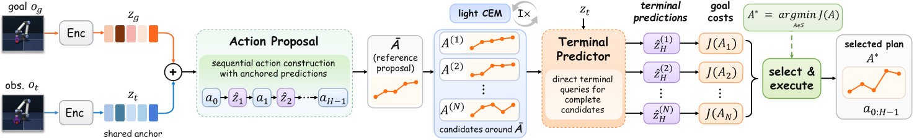
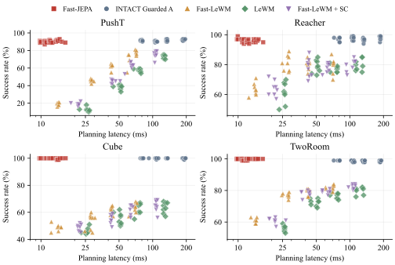

<p align="center"></p>
<p align="center"><strong>Advancing the Success–Latency Frontier for Latent World Models</strong></p>
<p align="center">Goal-directed proposals and direct terminal predictions for low-latency visual planning.</p>
<p align="center">
  Yao Zhang<sup>1,2,8</sup> · Bin Yu<sup>3,2,8</sup> · Shijie Lian<sup>4,2,8</sup> · Haishan Liu<sup>5,2</sup> · Changti Wu<sup>6,2</sup> · Yu Wu<sup>1,†</sup> · Kai Chen<sup>2,7,8,†</sup><br>
  <sup>1</sup>Wuhan University &nbsp;&nbsp; <sup>2</sup>Zhongguancun Academy<br>
  <sup>3</sup>Harbin Institute of Technology &nbsp;&nbsp; <sup>4</sup>Huazhong University of Science and Technology<br>
  <sup>5</sup>Nanjing University &nbsp;&nbsp; <sup>6</sup>East China Normal University<br>
  <sup>7</sup>Zhongguancun Institute of Artificial Intelligence &nbsp;&nbsp; <sup>8</sup>DeepCybo<br>
  <sub>† Corresponding author</sub>
</p>


<div align="center">
<a href="https://deepcybo-physai.github.io/Fast-JEPA/">
    
</a>
<a href="https://www.alphaxiv.org/abs/2611.25927">
    
</a>
<a href="https://github.com/DeepCybo-PhysAI/Fast-JEPA/blob/main/LICENSE">
    
</a>
</div>


---

## Overview

Comparing action sequences through recursive world-model rollout can make online planning expensive. **Fast-JEPA** reorganizes predictive computation: it constructs a goal-directed reference plan, then compares complete candidate sequences through direct terminal predictions under a shared visual-goal objective.

This retains intermediate predictions where action construction needs them while avoiding recursive state rollout during candidate evaluation.

## Method

<p align="center"><a href="assets/figures/method-overview.pdf"></a></p>

1. **Encode the current observation and visual goal.** Represent both in a shared latent space.
2. **Construct a goal-directed proposal.** Sequential action construction uses intermediate predictions anchored to the current observed representation.
3. **Refine with lightweight CEM.** Sample alternatives around the proposal and score complete candidates with batched terminal queries. The proposal and best-so-far plan remain eligible.
4. **Select, execute, and replan.** Select the lowest goal-cost plan, execute a short action prefix, and replan from the next observation.

## Results

Main four-task comparison, from Table 1. Values are mean ± standard deviation as reported in the paper; task columns and average success rate (SR) are percentages. Plan (ms) denotes complete planning latency. These rows are **locally evaluated reference configurations**.

<table width="100%">
  <thead>
    <tr>
      <th align="center" width="160">Method</th>
      <th align="center" width="125">PushT</th>
      <th align="center" width="125">Reacher</th>
      <th align="center" width="125">Cube</th>
      <th align="center" width="125">TwoRoom</th>
      <th align="center" width="125">Avg.&nbsp;SR&nbsp;(%)</th>
      <th align="center" width="150">Plan&nbsp;(ms)</th>
    </tr>
  </thead>
  <tbody>
    <tr>
      <td align="center">INTACT</td>
      <td align="center">87.33±2.31</td>
      <td align="center">96.00±0.00</td>
      <td align="center">100.00±0.00</td>
      <td align="center">99.00±0.00</td>
      <td align="center">95.58±0.58</td>
      <td align="center">26.19±0.22</td>
    </tr>
    <tr>
      <td align="center">INTACT&nbsp;Guarded&nbsp;A</td>
      <td align="center">91.33±1.53</td>
      <td align="center">97.00±0.00</td>
      <td align="center">99.67±0.58</td>
      <td align="center">97.33±0.58</td>
      <td align="center">96.33±0.38</td>
      <td align="center">127.09±2.81</td>
    </tr>
    <tr>
      <td align="center"><strong>Fast&#8209;JEPA</strong></td>
      <td align="center"><strong>90.00±3.00</strong></td>
      <td align="center"><strong>96.33±1.15</strong></td>
      <td align="center"><strong>100.00±0.00</strong></td>
      <td align="center"><strong>99.67±0.58</strong></td>
      <td align="center"><strong>96.50±0.66</strong></td>
      <td align="center"><strong>10.88±0.04</strong></td>
    </tr>
  </tbody>
</table>

Fast-JEPA reaches **96.50%** average success at **10.88 ms** mean complete planning latency, a **2.41×** speedup over the locally evaluated INTACT configuration (26.19 / 10.88).

The main evaluation uses 100 episodes per task and three independently trained models. Latencies are warmed, batch-one, complete planning measurements on an NVIDIA RTX PRO 6000 Blackwell Server Edition. Hardware, timing boundaries, model configurations, and protocols matter when comparing results; published reference results are distinguished from local evaluations in the full paper.

<p align="center"><a href="assets/figures/success-latency.pdf"></a></p>

### Search-budget comparison

**Figure 5.** Five methods are evaluated with 32 search configurations each. The left panel shows per-task success–latency operating points; the right panel shows the highest observed success within each mean-latency budget.

<p align="center"><a href="assets/figures/search-budget-points.pdf"></a> <a href="assets/figures/search-budget-frontier.pdf"></a></p>

### Predictive refinement in action

**Figure 6.** Matched PushT and Cube cases share the same initial states and goals. Predictive refinement rescues two rollouts, with callouts highlighting alignment and grasp differences. Success is evaluated within 50 steps; asterisks mark retained successful terminal observations, and the rightmost panels show the goals.

<p align="center"><a href="assets/figures/predictive-refinement-cases.pdf"></a></p>

## DynaGoal

**DynaGoal** evaluates original-task models under changing control conditions and timing constraints, without benchmark-specific training or fine-tuning.

<table width="100%">
  <thead>
    <tr>
      <th align="center" width="125">Protocol</th>
      <th align="center" width="430">Evaluation&nbsp;condition</th>
      <th align="center" width="235">Fast-JEPA&nbsp;avg.&nbsp;SR&nbsp;(%)</th>
      <th align="center" width="145">Planning&nbsp;latency&nbsp;(ms)</th>
    </tr>
  </thead>
  <tbody>
    <tr>
      <td align="center">Shift</td>
      <td align="center">Changing goals or environment geometry</td>
      <td align="center">73.83±4.16</td>
      <td align="center">13.42±0.11</td>
    </tr>
    <tr>
      <td align="center">Deadline</td>
      <td align="center">Joint planning and execution time budget</td>
      <td align="center">87.67±0.38</td>
      <td align="center">13.75±0.03</td>
    </tr>
  </tbody>
</table>

Fast-JEPA results from Tables 2 and 3. Avg. SR denotes average success rate. Each protocol covers PushT, Reacher, Cube, and TwoRoom. OOD here refers to changed control conditions and execution constraints, rather than visual-domain or episode disjointness. See Appendix B.2 for case definitions, success criteria, and timing boundaries.

### DynaGoal-Delay

Success rates across PushT, Reacher, Cube, and TwoRoom under controlled total response delays of **0, 300, 500, and 800 ms**, with 100 episodes per task at each delay level.

<p align="center"><a href="assets/figures/dynamic-response-delay.pdf"></a></p>

---

<p align="center"><a href="#installation">Installation</a> &nbsp;&middot;&nbsp; <a href="#data-preparation">Data</a> &nbsp;&middot;&nbsp; <a href="#training">Training</a> &nbsp;&middot;&nbsp; <a href="#evaluation">Evaluation</a> &nbsp;&middot;&nbsp; <a href="#four-task-reproduction">Reproduction</a> &nbsp;&middot;&nbsp; <a href="#dynagoal-reproduction">DynaGoal protocols</a></p>

## Installation

Clone the repository and run the commands below from its root:

```bash
git clone https://github.com/DeepCybo-PhysAI/Fast-JEPA.git
cd Fast-JEPA
```

Datasets and checkpoints are not bundled. Prepare the datasets and train checkpoints using the steps below.

Use Linux x86_64, Python 3.10 and a CUDA-capable NVIDIA GPU. The locked environment
uses PyTorch 2.7.1+cu128 and TorchVision 0.22.1. Reference planning timings were
measured on an NVIDIA RTX PRO 6000 Blackwell GPU.

On Ubuntu 22.04, install the system dependencies:

```bash
sudo apt-get update
sudo apt-get install -y python3.10 python3.10-venv python3-pip \
  build-essential swig curl ca-certificates git ffmpeg zstd \
  libegl1 libgl1 libgles2 libglfw3 libglib2.0-0 \
  libx11-6 libxext6 libxrender1 libsm6 libasound2
```

Then install and check the Python environment:

```bash
bash scripts/install.sh
bash scripts/check_environment.sh
bash scripts/check_environment.sh --gpu
```

The installer creates `.venv` and installs the exact versions in
`requirements-blackwell.lock`. It also selects **pygame 2.6.1 / SDL 2.28.4** and
**opencv-python** as the active rendering backends. Keep this installation order:
pygame-ce and pygame share an import namespace, as do the two OpenCV variants.
The evaluation wrapper rejects the wrong pygame backend.

A compatible NVIDIA driver and EGL rendering support are required. GPU containers
must enable `NVIDIA_DRIVER_CAPABILITIES=compute,utility,graphics` when created;
setting it only after startup cannot inject missing driver libraries. Scripts set
`MUJOCO_GL=egl` and `PYOPENGL_PLATFORM=egl`.

`FAST_JEPA_PYTHON=/path/to/python` selects an existing compatible interpreter.
`FAST_JEPA_WHEELHOUSE` selects a cache for the three prefetched NVIDIA wheels.
Alternatively, use the supplied Dockerfile:

```bash
docker build -t fast-jepa .
docker run --rm --gpus all \
  -e NVIDIA_DRIVER_CAPABILITIES=compute,utility,graphics \
  -v /path/to/cache:/data \
  -v /path/to/results:/opt/fast-jepa/outputs fast-jepa
```

## Data preparation

Set the cache root and prepare the four datasets:

```bash
export STABLEWM_HOME="${STABLEWM_HOME:-$PWD/cache}"
bash scripts/prepare_data.sh --dry-run
bash scripts/prepare_data.sh
```

Pinned revisions and archive SHA256 values are in `data/manifests/`. The preparer
supports resuming downloads, verifies the archives, extracts HDF5 and converts
PushT to Lance. Reserve space for archives and the prepared data together.

| Task | Public source | Prepared paths under `datasets/` |
|---|---|---|
| PushT | https://huggingface.co/datasets/quentinll/lewm-pusht | `pusht_expert_train.h5`, `pusht_expert_train.lance/` |
| Cube | https://huggingface.co/datasets/quentinll/lewm-cube | `ogbench/cube_single_expert.h5` |
| Reacher | https://huggingface.co/datasets/quentinll/lewm-reacher | `reacher.h5` |
| TwoRoom | https://huggingface.co/datasets/quentinll/lewm-tworooms | `tworoom.h5` |

Both `STABLEWM_HOME` and optional `LOCAL_DATASET_DIR` refer to the **parent** of
`datasets/`, not the dataset directory itself:

```text
cache/
  datasets/
    pusht_expert_train.h5
    pusht_expert_train.lance/
    ogbench/cube_single_expert.h5
    reacher.h5
    tworoom.h5
  checkpoints/
```

To reuse existing prepared data, set
`LOCAL_DATASET_DIR=/path/to/benchmark-cache`. Training outputs still use
`STABLEWM_HOME/checkpoints/`. PushT trains from Lance and evaluates from HDF5;
the other tasks use HDF5 for both.

Optional preparation commands:

```bash
bash scripts/prepare_data.sh --tasks pusht cube
bash scripts/prepare_data.sh --download-only
bash scripts/prepare_data.sh --skip-convert
bash scripts/prepare_data.sh --convert-only
bash scripts/prepare_data.sh --downloader aria2 --connections 8
```

## Training

Train one complete epoch for one task and training seed:

```bash
bash scripts/train.sh pusht 0
```

The tasks are `pusht`, `cube`, `reacher`, and `tworoom`; the training seeds are
0, 42, and 3072. For the complete grid:

```bash
for seed in 0 42 3072; do
  for task in pusht cube reacher tworoom; do
    bash scripts/train.sh "$task" "$seed"
  done
done
```

Training uses a seeded 90/10 split at the **clip** level, not the episode level.
Each run writes to `$STABLEWM_HOME/checkpoints/fast_TASK_sSEED_e1/`. Existing run
directories are not overwritten. Keep these checkpoint files together:

- `weights_epoch_1.pt`: model state dictionary;
- `config.json`: model architecture for strict loading;
- `run_metadata.json`: task, training seed and numerical policy.

## Evaluation

Evaluate a trained checkpoint using evaluation seed 42:

```bash
bash scripts/eval.sh pusht "$STABLEWM_HOME/checkpoints/fast_pusht_s0_e1/weights_epoch_1.pt" 42
```

The default is 100 episodes with **CEM64×2/top8**, CUDA Graph `all`, encoding
cache, unused-terminal proposal pruning and the original Actor action history.
H5/R5/block5 executes 25 primitive environment steps before each real observation.
Results and videos are written under `outputs/`.

Measure warmed, single-environment complete-planning latency:

```bash
PYTHONPATH=inference .venv/bin/python inference/benchmark_paired.py \
  --checkpoint "$STABLEWM_HOME/checkpoints/fast_pusht_s0_e1/weights_epoch_1.pt" \
  --mode fast_guarded --output outputs/pusht_b1_latency.json
```

<details>
<summary>Protocol details</summary>

The timer uses 5 warmups and 20 synchronized batch-one measurements. It includes
Actor, CEM and CPU output copy; it excludes loading, preprocessing, simulation
and CUDA Graph initialization. Graph setup is recorded separately. Changing input
or candidate shapes may require another capture. Batched evaluation wall time is
not the same measurement as batch-one planning latency.

</details>

## Four-task reproduction

After training all twelve checkpoints:

```bash
bash scripts/evaluate_all.sh --checkpoint-root "$STABLEWM_HOME/checkpoints" --dry-run
bash scripts/evaluate_all.sh --checkpoint-root "$STABLEWM_HOME/checkpoints" \
  --output "$PWD/outputs/main"
```

This evaluates 100 episodes per task/checkpoint at evaluation seed 42 and measures
batch-one latency independently for each checkpoint. Use a fresh output directory.
The outputs are `RESULTS.csv`, `SUMMARY.json`, and `SUMMARY.md`.

Macro averages the four tasks **within each training seed first**, then reports
mean, sample SD and sample variance across the three training seeds (`ddof=1`).
Missing cells are an error. Full settings are in
[reproducibility/SETTING.json](reproducibility/SETTING.json).

## DynaGoal reproduction

This distribution reproduces the **Fast-JEPA rows** of Tables 1–3. Other methods
and component ablations are not included. All three tables reuse the twelve
original-task checkpoints trained above, with no DynaGoal fine-tuning.

```bash
bash scripts/reproduce_tables.sh "$STABLEWM_HOME/checkpoints" "$PWD/outputs/tables"
```

This runs 1,200 episodes for Table 1, 1,200 for Table 2 (Shift), and 1,200 for
Table 3 (Deadline). Each table writes taskwise and Macro mean, sample SD and
sample variance across training seeds 0/42/3072. Existing result directories are
never silently reused or overwritten.

Run either DynaGoal table separately:

```bash
bash scripts/evaluate_dynagoal.sh --subset shift \
  --checkpoint-root "$STABLEWM_HOME/checkpoints" --output "$PWD/outputs/table2"
bash scripts/evaluate_dynagoal.sh --subset deadline \
  --checkpoint-root "$STABLEWM_HOME/checkpoints" --output "$PWD/outputs/table3"
```

DynaGoal-Delay uses the same Shift dynamics at imposed total response delays
0/300/500/800 ms, with its own frozen evaluation windows 0/42/3072 (100 cases
per window). It is separate from the measured delay in Table 2:

```bash
bash scripts/evaluate_dynagoal.sh --subset delay \
  --checkpoint-root "$STABLEWM_HOME/checkpoints" --output "$PWD/outputs/delay"
```

The command above evaluates all three training seeds and all three Delay
windows, totaling 14,400 episodes.

<details>
<summary>Protocol details: Delay aggregation</summary>

Window 0 and window 42 overlap in 58 integer
cases; they are not independent cohorts. Aggregation first averages windows
within each trained model, then computes mean and sample SD across models.

</details>

### Figure 4: Fast-JEPA Delay curves

Fig.4 (DynaGoal-Delay) uses a historical selection of trained weights and
windows per task, rather than this full-grid aggregate. Its exact Fast-JEPA
results have a separate entry point (no plotting):

```bash
bash scripts/evaluate_delay_figure.sh --checkpoint-root "$STABLEWM_HOME/checkpoints" \
  --output "$PWD/outputs/paper_delay"
```

The settings are recorded in `dynagoal/settings.json`. This command evaluates
Fast-JEPA and exports `PAPER_CURVES.json`, `PAPER_CURVES.csv`, and
`PAPER_RESULTS.md`. Per-episode actions, outcomes, planning times and resolved
configurations are saved with the results.

The exact Fig.4 Fast-JEPA settings are:

| Task | Training seed(s) | Evaluation window start | Episodes per checkpoint per delay |
|---|---|---:|---:|
| PushT | 0 | 42 | 100 |
| Reacher | 42 | 0 | 100 |
| Cube | 42 | 0 | 100 |
| TwoRoom | 0/42/3072 | 0 | 100 |

The four response delays are 0/300/500/800 ms. Each selected checkpoint
runs 400 episodes, for 2,400 episodes in total. TwoRoom averages the three
training seeds and reports sample SD; the other tasks use one selected
checkpoint each. The fixed cases and condition profiles are included.

<details>
<summary>Protocol details</summary>

Fig.4 uses the same 100-step Shift dynamics and 25-step feedback, CEM64×2/top8,
CUDA Graph, encoding cache and terminal-WM pruning. The imposed delay sets
the total response interval; buffered/held actions continue during the wait.

`dynagoal/settings.json` fixes all eight conditions. The 100 original cases per
condition are stored in `dynagoal/cases/`, with checked hashes; they must not be
resampled using Table 1's evaluation seed 42. Cases and conditions were selected
through exploratory comparisons and are frozen development cases, not an
independent held-out evaluation. Their full case objects are preserved.

| Condition | Original evaluator setting |
|---|---|
| Shift PushT | Physical block drift 2 pixels/s, reversal after step 50; success throughout final 25 steps |
| Shift Reacher | Target switch at step 75; success strictly before and after switch |
| Shift Cube | Target switch at step 25; success in both stages |
| Shift TwoRoom | Sliding doorway amplitude 8 pixels, period 20 s, phase 0; fixed physical goal, updated goal image; success throughout final 25 steps |
| Deadline PushT / Reacher / Cube / TwoRoom | 2.50 / 1.20 / 1.25 / 2.50 s |

Shift runs 100 primitive steps, with observations every 25 steps. During measured
planning delay the environment advances in native ticks using buffered actions,
holding the last action when the queue is empty. A new plan replaces the queue
once ready. Delay uses this same scheduler but replaces the total response
interval with the imposed value; it does not add delay to compute time.

Deadline runs the static environments. A first native goal hit succeeds only
when execution duration plus cumulative **actual measured** decision time is
within the deadline. Online timing includes preprocessing, complete planning,
CPU output and inverse normalization; simulation, rendering, loading, warm-up
and CUDA Graph initialization are excluded. This differs from Table 1's
independent fixed-input timing, which excludes preprocessing and inverse
normalization. Raw episodes, timings, source/checkpoint/case hashes, warm-up and
native-loop checks are saved. The native-loop gate requires exact executed
actions and success against the original environment evaluation loop.

Historical details needed for faithful reproduction: PushT's `reverse_drift`
applies a disturbance to the physical block, rather than moving the goal.
All four Deadline tasks use a 50-step cap. The archived Fast-JEPA Reacher
traces used 100 steps; the current 50-step cap preserves the deadline success
outcomes, while mean planning latency may differ slightly.

Newly trained checkpoints are accepted directly. Evaluation records whether
their hashes match the original paper checkpoints listed in
`dynagoal/checkpoint_hashes.json`. Measured latency and time-sensitive outcomes
can vary with hardware and load; use the locked environment and reference
hardware for closest agreement.

</details>

## Acknowledgments and license

Fast-JEPA builds on [INTACT-JEPA](https://github.com/zju3dv/INTACT-JEPA),
[Fast-LeWorldModel](https://github.com/Yuntian-Gao/Fast-LeWorldModel), and
[LeWM](https://github.com/lucas-maes/le-wm). We thank their authors for
releasing their code.

The project is released under the [MIT License](LICENSE). Upstream copyright
and license notices are included in the same file.

## Citation

If you find our work useful, please consider citing:

```bibtex
@misc{zhang2026fastjepa,
  title         = {Fast-JEPA: Advancing the Success--Latency Frontier for Latent World Models},
  author        = {Zhang, Yao and Yu, Bin and Lian, Shijie and Liu, Haishan and Wu, Changti and Wu, Yu and Chen, Kai},
  year          = {2026},
  eprint        = {2611.25927},
  archivePrefix = {arXiv},
  primaryClass  = {cs.RO},
  url           = {https://arxiv.org/abs/2611.25927}
}
```
