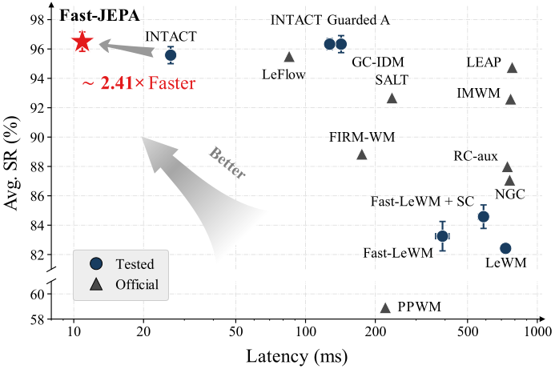
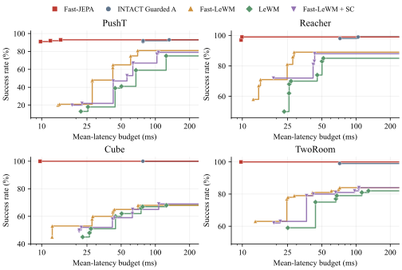
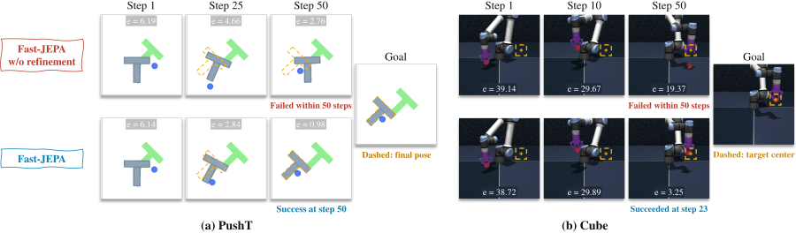
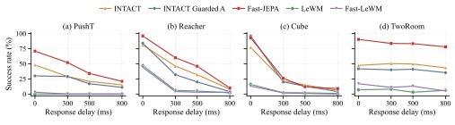

<p align="center"></p>
<p align="center"><strong>Advancing the Success–Latency Frontier for Latent World Models</strong></p>
<p align="center">Goal-directed proposals and direct terminal predictions for low-latency visual planning.</p>
<p align="center">
  Yao Zhang<sup>1,2,8</sup> · Bin Yu<sup>3,2,8</sup> · Shijie Lian<sup>4,2,8</sup> · Haishan Liu<sup>5,2</sup> · Changti Wu<sup>6,2</sup> · Yu Wu<sup>1,†</sup> · Kai Chen<sup>2,7,8,†</sup><br>
  <sup>1</sup>Wuhan University &nbsp;&nbsp; <sup>2</sup>Zhongguancun Academy<br>
  <sup>3</sup>Harbin Institute of Technology &nbsp;&nbsp; <sup>4</sup>Huazhong University of Science and Technology<br>
  <sup>5</sup>Nanjing University &nbsp;&nbsp; <sup>6</sup>East China Normal University<br>
  <sup>7</sup>Zhongguancun Institute of Artificial Intelligence &nbsp;&nbsp; <sup>8</sup>DeepCybo<br>
  <sub>† Corresponding author</sub>
</p>


<div align="center">
<a href="https://deepcybo-physai.github.io/Fast-JEPA/">
    
</a>
<a href="https://www.alphaxiv.org/abs/2611.25927">
    
</a>
<a href="https://github.com/DeepCybo-PhysAI/Fast-JEPA/blob/main/LICENSE">
    
</a>
</div>


---

## Overview

Comparing action sequences through recursive world-model rollout can make online planning expensive. **Fast-JEPA** reorganizes predictive computation: it constructs a goal-directed reference plan, then compares complete candidate sequences through direct terminal predictions under a shared visual-goal objective.

This retains intermediate predictions where action construction needs them while avoiding recursive state rollout during candidate evaluation.

## Method

<p align="center"><a href="assets/figures/method-overview.pdf"></a></p>

1. **Encode the current observation and visual goal.** Represent both in a shared latent space.
2. **Construct a goal-directed proposal.** Sequential action construction uses intermediate predictions anchored to the current observed representation.
3. **Refine with lightweight CEM.** Sample alternatives around the proposal and score complete candidates with batched terminal queries. The proposal and best-so-far plan remain eligible.
4. **Select, execute, and replan.** Select the lowest goal-cost plan, execute a short action prefix, and replan from the next observation.

## Results

Main four-task comparison, from Table 1. Values are mean ± standard deviation as reported in the paper; task columns and average success rate (SR) are percentages. Plan (ms) denotes complete planning latency. These rows are **locally evaluated reference configurations**.

<table width="100%">
  <thead>
    <tr>
      <th align="center" width="160">Method</th>
      <th align="center" width="125">PushT</th>
      <th align="center" width="125">Reacher</th>
      <th align="center" width="125">Cube</th>
      <th align="center" width="125">TwoRoom</th>
      <th align="center" width="125">Avg.&nbsp;SR&nbsp;(%)</th>
      <th align="center" width="150">Plan&nbsp;(ms)</th>
    </tr>
  </thead>
  <tbody>
    <tr>
      <td align="center">INTACT</td>
      <td align="center">87.33±2.31</td>
      <td align="center">96.00±0.00</td>
      <td align="center">100.00±0.00</td>
      <td align="center">99.00±0.00</td>
      <td align="center">95.58±0.58</td>
      <td align="center">26.19±0.22</td>
    </tr>
    <tr>
      <td align="center">INTACT&nbsp;Guarded&nbsp;A</td>
      <td align="center">91.33±1.53</td>
      <td align="center">97.00±0.00</td>
      <td align="center">99.67±0.58</td>
      <td align="center">97.33±0.58</td>
      <td align="center">96.33±0.38</td>
      <td align="center">127.09±2.81</td>
    </tr>
    <tr>
      <td align="center"><strong>Fast&#8209;JEPA</strong></td>
      <td align="center"><strong>90.00±3.00</strong></td>
      <td align="center"><strong>96.33±1.15</strong></td>
      <td align="center"><strong>100.00±0.00</strong></td>
      <td align="center"><strong>99.67±0.58</strong></td>
      <td align="center"><strong>96.50±0.66</strong></td>
      <td align="center"><strong>10.88±0.04</strong></td>
    </tr>
  </tbody>
</table>

Fast-JEPA reaches **96.50%** average success at **10.88 ms** mean complete planning latency, a **2.41×** speedup over the locally evaluated INTACT configuration (26.19 / 10.88).

The main evaluation uses 100 episodes per task and three independently trained models. Latencies are warmed, batch-one, complete planning measurements on an NVIDIA RTX PRO 6000 Blackwell Server Edition. Hardware, timing boundaries, model configurations, and protocols matter when comparing results; published reference results are distinguished from local evaluations in the full paper.

<p align="center"><a href="assets/figures/success-latency.pdf"></a></p>

### Search-budget comparison

**Figure 5.** Five methods are evaluated with 32 search configurations each. The left panel shows per-task success–latency operating points; the right panel shows the highest observed success within each mean-latency budget.

<p align="center"><a href="assets/figures/search-budget-points.pdf"></a> <a href="assets/figures/search-budget-frontier.pdf"></a></p>

### Predictive refinement in action

**Figure 6.** Matched PushT and Cube cases share the same initial states and goals. Predictive refinement rescues two rollouts, with callouts highlighting alignment and grasp differences. Success is evaluated within 50 steps; asterisks mark retained successful terminal observations, and the rightmost panels show the goals.

<p align="center"><a href="assets/figures/predictive-refinement-cases.pdf"></a></p>

## DynaGoal

**DynaGoal** evaluates original-task models under changing control conditions and timing constraints, without benchmark-specific training or fine-tuning.

<table width="100%">
  <thead>
    <tr>
      <th align="center" width="125">Protocol</th>
      <th align="center" width="430">Evaluation&nbsp;condition</th>
      <th align="center" width="235">Fast-JEPA&nbsp;avg.&nbsp;SR&nbsp;(%)</th>
      <th align="center" width="145">Planning&nbsp;latency&nbsp;(ms)</th>
    </tr>
  </thead>
  <tbody>
    <tr>
      <td align="center">Shift</td>
      <td align="center">Changing goals or environment geometry</td>
      <td align="center">73.83±4.16</td>
      <td align="center">13.42±0.11</td>
    </tr>
    <tr>
      <td align="center">Deadline</td>
      <td align="center">Joint planning and execution time budget</td>
      <td align="center">87.67±0.38</td>
      <td align="center">13.75±0.03</td>
    </tr>
  </tbody>
</table>

Fast-JEPA results from Tables 2 and 3. Avg. SR denotes average success rate. Each protocol covers PushT, Reacher, Cube, and TwoRoom. OOD here refers to changed control conditions and execution constraints, rather than visual-domain or episode disjointness. See Appendix B.2 for case definitions, success criteria, and timing boundaries.

### DynaGoal-Delay

Success rates across PushT, Reacher, Cube, and TwoRoom under controlled total response delays of **0, 300, 500, and 800 ms**, with 100 episodes per task at each delay level.

<p align="center"><a href="assets/figures/dynamic-response-delay.pdf"></a></p>

## Citation

If you find our work useful, please consider citing:

```bibtex
@misc{zhang2026fastjepa,
  title         = {Fast-JEPA: Advancing the Success--Latency Frontier for Latent World Models},
  author        = {Zhang, Yao and Yu, Bin and Lian, Shijie and Liu, Haishan and Wu, Changti and Wu, Yu and Chen, Kai},
  year          = {2026},
  eprint        = {2611.25927},
  archivePrefix = {arXiv},
  primaryClass  = {cs.RO},
  url           = {https://arxiv.org/abs/2611.25927}
}
```

## Contributing and support

For now, contributions focus on documentation corrections and questions about the paper. See [contribution guidance](.github/CONTRIBUTING.md) and [support information](.github/SUPPORT.md). Implementation-related instructions will be added when the code is released.

